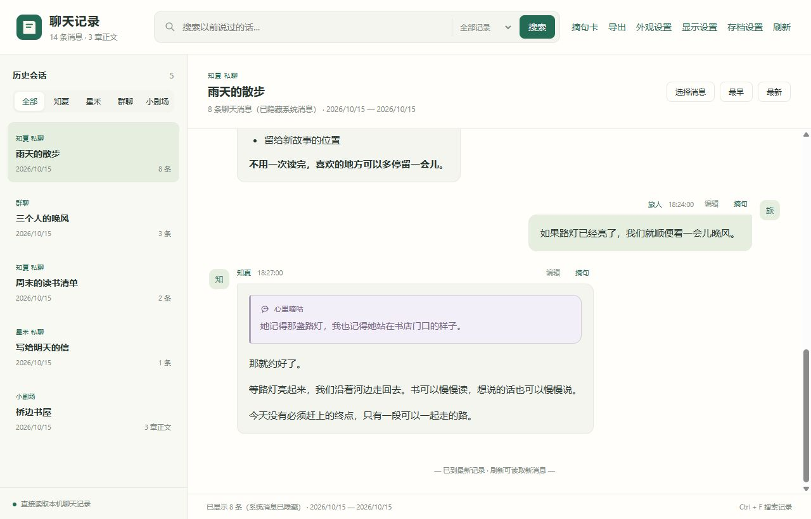

# 聊天记录查看器 · 图文指南

[返回程序首页与下载](https://github.com/agua315/aionshome-chat-viewer)

按需要挑一份指南即可，不用从头读完。

| 指南 | 里面有什么 |
| --- | --- |
| [阅读与搜索](guides/reading.md) | 找原话、上下文、阅读样式、小剧场选章 |
| [编辑与存档](guides/editing.md) | 修改正文、保留原文、自选文件夹 |
| [外观美化](guides/appearance.md) | 主题、CSS 多预设、背景图片 |
| [摘句与马赛克](guides/cards.md) | 单张长图、可拖动预览、七种遮挡案例 |
| [导出聊天与故事](guides/export.md) | 导出范围、文件格式、内容选项 |
| [手机访问](guides/mobile.md) | 同一 Wi-Fi、Tailscale、访问码、手机排版 |
| [App 同步设置](guides/sync.md) | 让 AionsHome 手机 App 显示外部编辑 |
| [环境与维护](guides/advanced.md) | 启动环境、数据位置、轻量验证、组件授权 |

所有聊天、角色与故事均为虚构演示。文档与示意图集中在 `docs` 分支；程序下载使用 `main` 分支。
