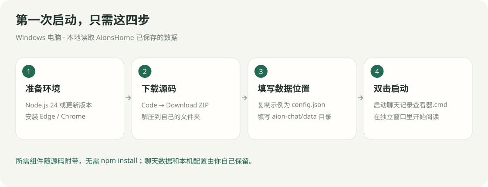
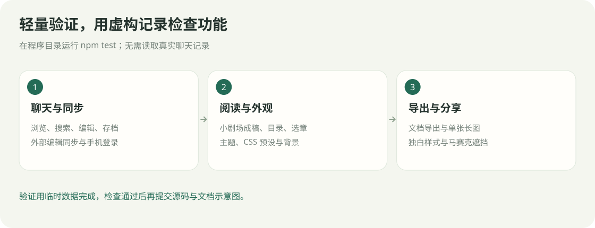

# 环境、数据位置与维护

[返回指南目录](../README.md) · [下载程序](https://github.com/agua315/aionshome-chat-viewer/archive/refs/heads/main.zip)

## 启动环境

- Windows、Node.js 24 或更新版本、Edge 或 Chrome。源码已在 Node.js v24.16.0 下验证。
- 所需组件随程序附带，无需 `npm install`；也可在程序目录运行 `npm start`。
- 便携环境可把 `node.exe` 放进 `runtime`，启动脚本会优先使用它。
- 关闭运行面板，或双击 `停止聊天记录查看器.cmd`，即可停止。

## 数据放在哪里

| 内容 | 位置 |
| --- | --- |
| 原聊天和本地附件 | 你在 `config.json` 中填写的 AionsHome 数据目录 |
| 查看器设置 | 本机 `config.json` |
| 自选背景与卡片配图 | 查看器的 `user-data/backgrounds` |
| 编辑前原文存档 | 存档设置中选择的目录 |
| 导出文件与摘句图片 | 当前设备的浏览器下载目录 |

程序文件夹可以移动；原数据目录变化时，更新配置即可。已经删除的附件无法凭空恢复，外部链接需要原资源仍可访问。

## 轻量验证

在程序目录运行 `npm test`，或用 `node verify.js` 做基础检查。

验证使用临时虚构记录，覆盖聊天翻页、搜索、编辑、存档、同步、手机访问、小剧场、外观、导出、长图和马赛克。

## 组件与授权

- Markdown：markdown-it 15.0.1，授权见程序的 `public/vendor/markdown-it.LICENSE.txt`。
- 文档导出：docx 9.6.1、PptxGenJS 4.0.1、JSZip 3.10.1，授权见 `vendor/licenses`。
- PptxGenJS 的 JSZip 引用改为随程序附带的本地副本。
- 图标生成脚本为 `Build-Icon.ps1`，成品在 `public/chat-viewer.ico`。
