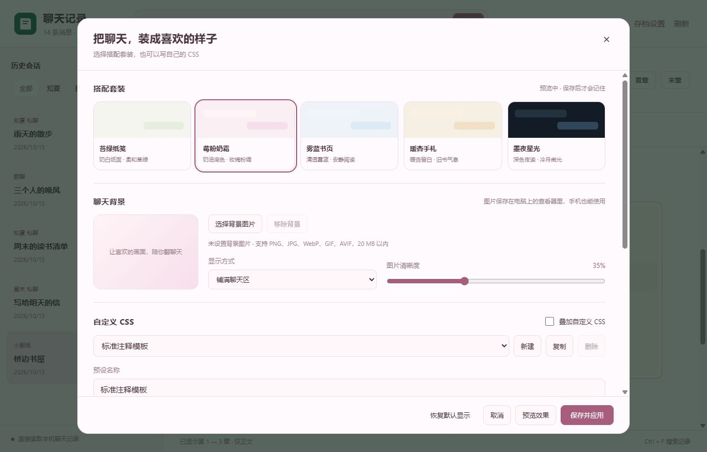

# 外观美化

[返回指南目录](../README.md)

## 直接选一套搭配

打开“外观设置”，从苔绿纸笺、莓粉奶霜、雾蓝书页、暖杏手札、墨夜星光中选一套。

套装会调整按钮、侧栏、气泡和特殊消息配色。点“预览效果”先看，满意后“保存并应用”。

## 自己写 CSS

1. 启用“叠加自定义 CSS”。
2. 在已预填的标准模板中修改。每一节都有中文注释，说明对应的界面区域。
3. 给预设起名，再点“保存并应用”。可按 `Ctrl + Enter` 或 `Ctrl + S` 保存。

“新建 / 复制 / 删除”管理多份预设。“填入标准模板”可重新填入注释代码。

按钮、气泡、头像、字体、侧栏、独白、手表、拍一拍、Markdown、小剧场和手机排版都能调整。

## 用自己的背景图

点“选择背景图片”，再选铺满、完整显示或平铺，并调整图片清晰度。

- 支持 PNG、JPG、WebP、GIF、AVIF；单张不超过 20 MB。
- 电脑和已登录的手机都能上传；另一端刷新可读取保存后的设置。
- “移除背景”取消当前使用，保留图片文件。

## 写乱了怎么恢复

- “取消”恢复打开面板前的外观。
- “恢复默认显示”还原主题、停用 CSS、移除当前背景，保留已存的 CSS 预设。
- 电脑可按 `Ctrl + Shift + 0` 临时恢复默认。
- 手机可在地址末尾加 `?safeAppearance=1` 打开，再修改外观。

设置保存在哪里

CSS 预设和当前选择保存在本机 `config.json`；背景图片在 `user-data/backgrounds`。两者均被 Git 忽略，不随源码上传。

