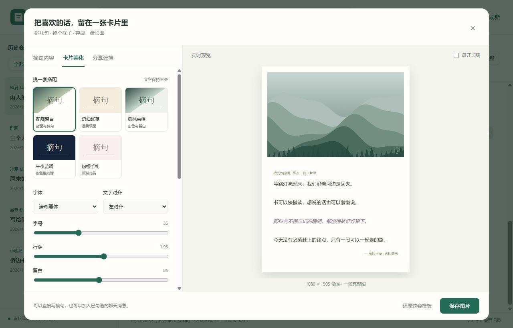
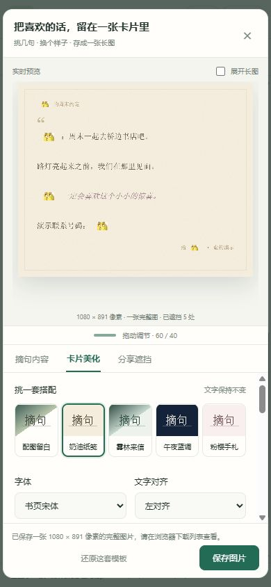
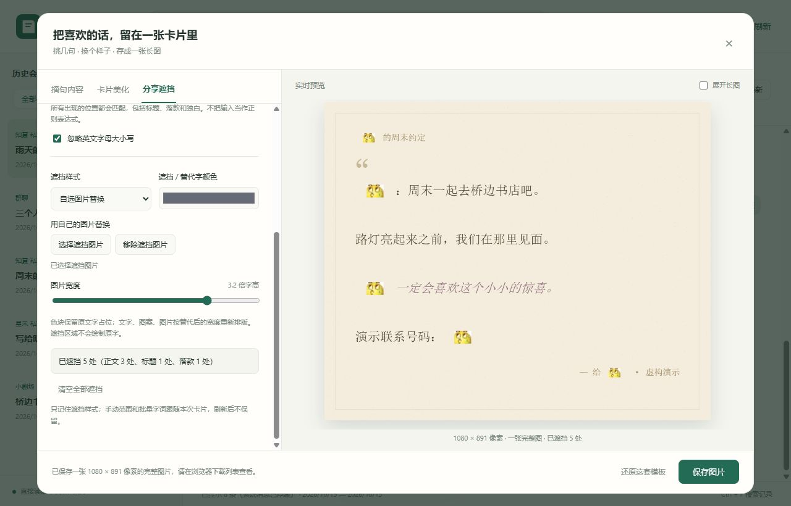
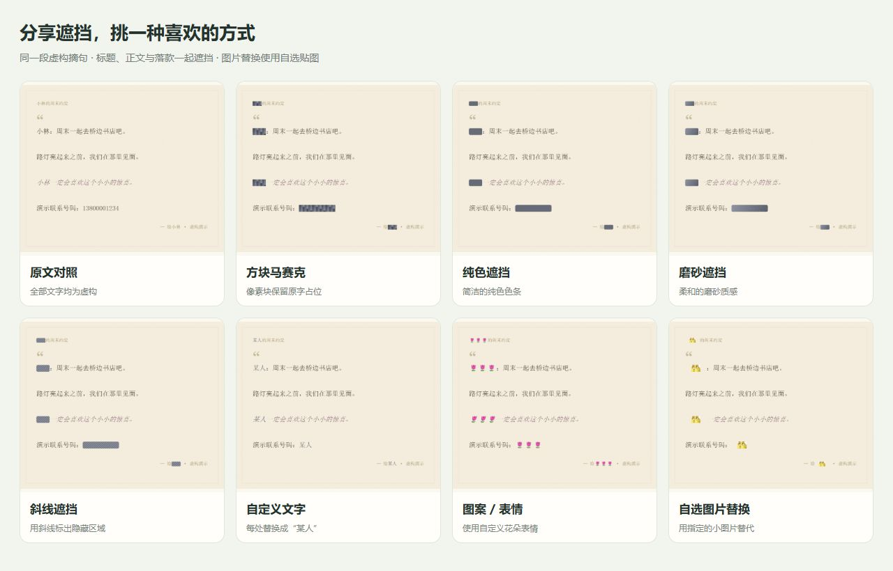

# 摘句与马赛克

[返回指南目录](../README.md)

## 先放入喜欢的话

任选一种方式：

- 点消息或章节旁的“摘句”。长消息和小剧场可以逐句勾选。
- 在正文中划选文字，点“用选中文字做卡”；手机可长按选择。
- 勾选多条消息，再点“制作摘句卡”。
- 直接打开顶部“摘句卡”，自己输入。

文字、换行、标题和落款都能修改，只影响分享图片，不写回聊天。

## 美化并保存

1. 在“卡片美化”选模板，调整字体、字号、行距、配色和留白。
2. 可上传配图，或使用聊天背景；配图可以放上方或铺满整张。
3. 选 PNG 或 JPG，点“保存图片”，下载到当前设备。

长内容会生成 **一张完整长图**。预览默认缩小显示整张，勾选“展开长图”后可滚动查看。

## 手机预览太小怎么办

默认上方预览 60%、下方编辑 40%。上下拖动中间的分隔条即可调整，比例会在当前浏览器记住。

双击分隔条恢复 6:4；聚焦后也可用上下方向键调整。这里只改变界面空间，不改变图片尺寸。

## 遮挡不想分享的信息

- **只遮挡这一次**：在正文、标题或落款输入框选中几个字，点“遮挡所选”。
- **批量遮挡**：进入“分享遮挡”，每行填写一个字词，自动匹配所有出现位置。
- **随时撤销**：逐项取消、清空选择，或暂停遮挡。

手动范围和批量字词可以一起使用；批量匹配按字面处理，可忽略英文大小写。

## 七种现有效果

同一段虚构文字的对照如下。图片替换一项使用自选贴图；人物与号码均为演示内容。

| 样式 | 点击看清细节 |
| --- | --- |
| 原文对照 | [原尺寸图片](../images/mosaic-original.png) |
| 方块马赛克 | [原尺寸图片](../images/mosaic-pixel.png) |
| 纯色遮挡 | [原尺寸图片](../images/mosaic-solid.png) |
| 磨砂遮挡 | [原尺寸图片](../images/mosaic-frost.png) |
| 斜线遮挡 | [原尺寸图片](../images/mosaic-stripe.png) |
| 自定义文字 | [原尺寸图片](../images/mosaic-text.png) |
| 图案 / 表情 | [原尺寸图片](../images/mosaic-pattern.png) |
| 自选图片 | [原尺寸图片](../images/mosaic-image.png) |

长图、独白与草稿说明

- 图片宽度可选 900 / 1080 / 1440 像素；最短画幅可选自适应、方形、3:4、9:16，文字多时继续延长。
- 极长内容会适当降低输出尺寸；超过单张图片极限时会明确提示，不会悄悄删字。
- `[心里嘀咕：…]` / `【心里嘀咕：…】` 在图片中去掉标记，显示成斜体；“独白颜色”可单独调整。
- 遮挡后的原字不会绘入最终图片，文件名也使用遮挡后的标题；编辑框保留原文。
- 色块保留占位；文字、图案和图片替换会重新排版。图片未选或读取失败时用色块暂代预览，并提示处理后再保存。
- 配图支持 PNG、JPG、WebP、GIF、AVIF，20 MB 以内；GIF 保存为静态画面。
- 样式记在当前浏览器；摘句正文、手动范围和批量字词只保留在当前页面，刷新后不保留。

