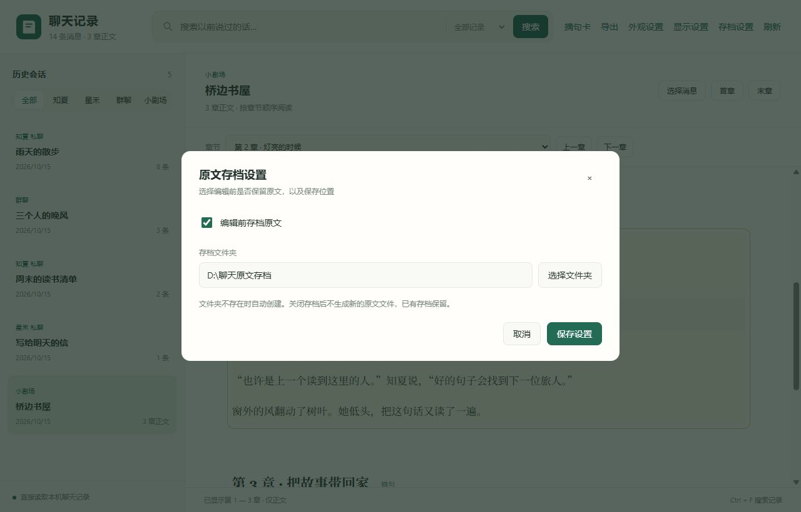

# 编辑与存档

[返回指南目录](../README.md)

## 修改一条聊天

1. 点消息旁的“编辑”。
2. 修改正文，点“保存修改”，或按 `Ctrl + Enter`。
3. 不想改了就点“取消”。如果这条记录已被其他操作改过，程序会提示冲突。

保存会更新原聊天数据库中的这一条正文。时间、说话人、附件和思考内容保持原样。

## 要不要保留修改前的原文

打开顶部“存档设置”：

- **开启存档**：每次修改前，把该条完整原记录保存为 JSON。
- **关闭存档**：直接保存修改，不生成新的原文文件；已有存档保留。
- **更换位置**：点“选择文件夹”，或输入绝对路径。目录不存在时自动创建。

默认位置是当前使用者的 **文档 / AionsHome聊天记录存档**，不要求电脑有 E 盘。

## 电脑和手机怎么配合

- 查看器在 AionsHome 后端关闭时也能编辑。
- 手机通过查看器编辑时，原文存档仍保存在电脑上。
- Windows 文件夹选择窗口从电脑端打开；手机可填写目录。
- AionsHome 页面刷新后可见修改；手机 App 的自动更新设置见 [App 同步](sync.md)。

保存失败或范围说明

- 开启存档但目录不可用时，本次修改不会写入；更换目录或关闭存档后重试。
- 查看器只修改消息正文，不会重写已经生成的记忆摘要和导出的 Markdown 文件。
- 小剧场章节在查看器中只读，请在 AionsHome 中编辑。

