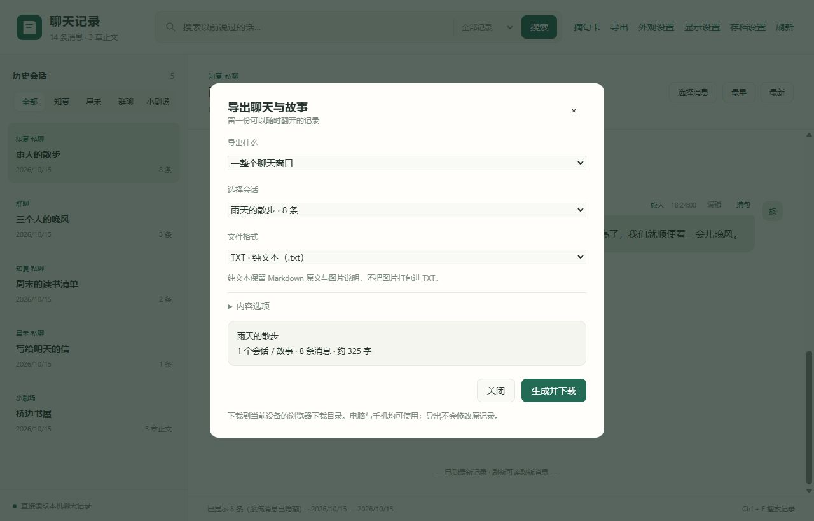

# 导出聊天与故事

[返回指南目录](../README.md)

## 怎么导出

1. 点顶部“导出”。
2. 选范围、文件格式和内容选项。
3. 点“生成并下载”，到当前设备的浏览器下载目录查看。

## 可以选哪些内容

| 范围 | 导出内容 |
| --- | --- |
| 一个完整聊天窗口 | 该会话全部记录，不受网页当前加载条数限制 |
| 勾选消息 / 章节 | 先用“选择消息”勾选，再导出所选 |
| 所有命中消息 | 先搜索，再导出全部命中的完整原文 |
| 命中所在的完整会话 | 导出命中会话的全部上下文 |
| 小剧场整本 / 选章 | 只导出已写出的正文与插图，按章节排序 |

选择翻页时会保留，刷新页面后清空。“全选已加载消息”只选当前已加载的内容。

## 格式怎么挑

| 格式 | 适合用途 |
| --- | --- |
| TXT | 纯文字，保留 Markdown 原文 |
| DOCX | Word / WPS 中继续编辑 |
| PPTX | 按消息分页的幻灯片，长消息会继续分页 |
| EPUB | 像电子书一样阅读，带会话 / 章节目录 |
| PDF | 固定纸面排版，方便阅读或打印 |

DOCX / PPTX 使用现代格式。PDF 需要电脑已安装 Edge 或 Chrome；导出不需要 Office 或 AionsHome 后端。

## 内容选项

可以选择系统消息、普通图片、监控截图、思考内容和聊天时间。监控截图与思考内容默认不导出。

导出不修改原数据库；使用独立排版，不带自定义界面 CSS 或聊天背景。

图片、附件和搜索结果细节

- 搜索导出会取完全部分页，沿用搜索时的范围；导出前显示记录数量。
- 手动勾选的消息会准确导出，系统消息默认跟随阅读设置。
- 图片只从本地附件读取，不下载外部资源；缺失时保留说明。
- PNG、JPG、GIF 可嵌入图文格式；WebP、AVIF 在 PDF / EPUB 中保留，在 Word / PPT 中用文字提示代替。
- TXT 不嵌入图片；音视频保留说明、地址与已有转写文字，不把文件打包进去。
- PDF 中间文件生成后会自动清理。

