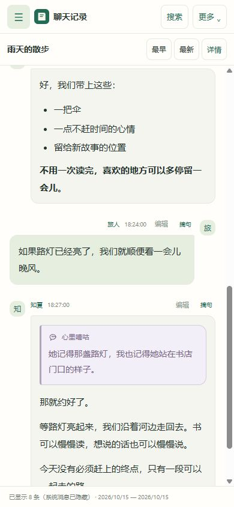

# 手机访问

[返回指南目录](../README.md)

电脑和查看器需要开着；AionsHome 后端可以关闭。手机直接用浏览器访问，不需要导入聊天数据库。

## 电脑先设置一次

1. 使用示例配置，或在 `config.json` 中加入 `"phoneAccess": { "enabled": true }`，重启查看器。
2. 双击 `设置手机访问.cmd`，允许 Windows 管理员确认，设置查看器的防火墙规则。
3. 在电脑查看器点“手机访问”，查看连接地址与八位访问码。

## 手机怎么打开

| 所在网络 | 打开方法 |
| --- | --- |
| 同一 Wi-Fi | 手机浏览器打开面板中的 Wi-Fi 地址 |
| 不同网络 | 手机先接入同一个 Tailscale 网络，再打开 Tailscale 地址 |

输入访问码进入。浏览器记住登录状态 30 天，点“退出”可注销。

## 手机上的按钮在哪里

- **左上角菜单**：会话列表或搜索结果，选中后回到正文。
- **搜索**：展开输入栏，提交后自动收起并打开结果。
- **更多**：摘句卡、导出、外观和其他设置。
- **详情**：完整会话标题、日期、消息数量和“选择消息”。

## 连接或设置有变化

- Wi-Fi 地址可能变化，以电脑“手机访问”面板为准。
- Tailscale 地址取自电脑网卡，不需要 Tailscale Serve 或 Cloudflare。
- 端口默认 4328。自定义端口时，可运行 `设置手机访问防火墙.ps1 -Port 你的端口`。
- 编辑前的原文存档留在电脑上，保存摘句图或导出文件则下载到当前操作的设备。

本机配置说明

- 首次开启会生成该电脑独立的访问码和登录密钥，保存在被 Git 忽略的本机配置中。
- 这些地址通过 HTTP 打开，Tailscale 路径由 Tailscale 连接传输。
- 防火墙脚本仅设置查看器端口，来源限同网段和 Tailscale IPv4。
- 网络访问使用固定端口，占用时会提示调整配置。
- 设为 `"phoneAccess": { "enabled": false }` 后重启查看器，可恢复只允许本机访问。

