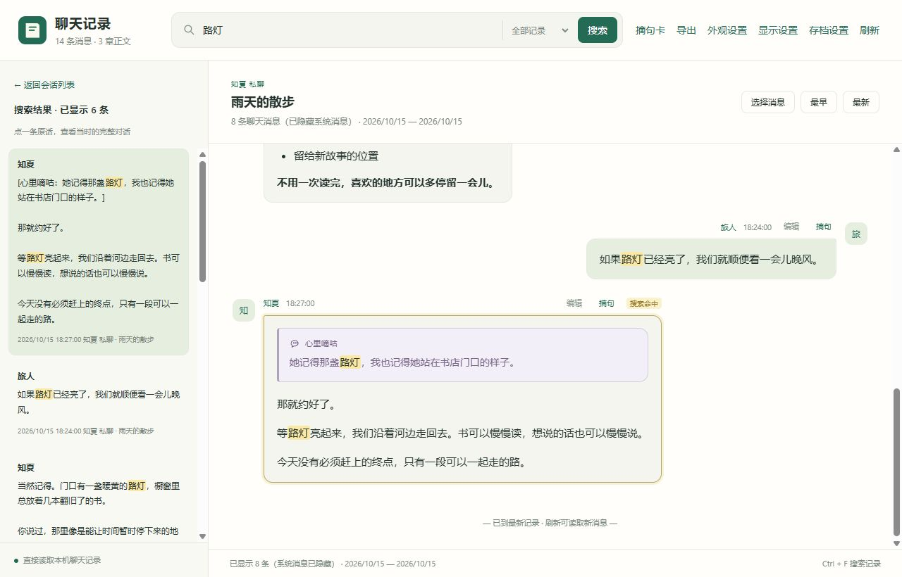
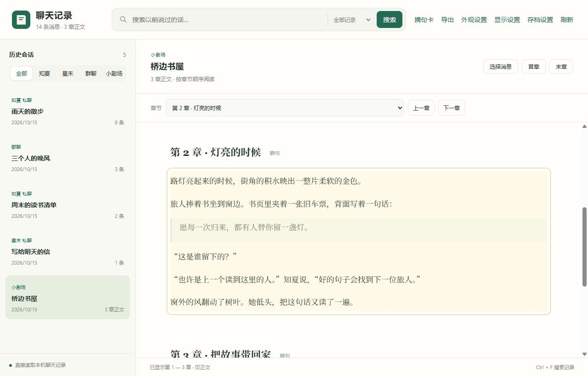

# 阅读与搜索

[返回指南目录](../README.md) · [程序首页](https://github.com/agua315/aionshome-chat-viewer)

## 找以前说过的话

1. 在顶部输入关键词，点“搜索”。电脑可按 `Ctrl + F` 聚焦输入框。
2. 左边点一条结果，右边就会显示原话、关键词高亮和前后对话。
3. 继续加载更早 / 更新的记录，或返回会话列表。

搜索范围可以选全部记录、当前会话或小剧场正文。结果列表支持继续加载。

## 平时怎么读

左边选会话，右边看内容。“最早 / 最新”跳到会话两端；加载按钮继续翻页。本地图片、表情、音视频和附件也能查看。

在“显示设置”里选阅读样式：

| 样式 | 效果 |
| --- | --- |
| 聊天气泡（原文） | 保留原文格式，包括 Markdown 标记 |
| 聊天气泡（Markdown） | 显示加粗、斜体、引用、列表、表格、代码块等 |
| 小说阅读（Markdown） | 去掉气泡边框，使用较宽正文和更舒展的行距 |

同一面板还可以：

- 调整你的发言在左边还是右边。
- 分别开关你的名字、你的头像和角色头像。
- 隐藏系统消息；搜索和翻页也会过滤。
- 默认收起监控截图，点开后才加载。普通聊天图片正常显示。

## 小剧场选章节

1. 左侧选“小剧场”，再选一本故事。
2. 在顶部章节下拉框选想读的章节。
3. 用上一章 / 下一章切换，也可连续往下读；目录会跟随当前章。

正文保留插图，可以搜索和定位；大纲、讨论、旧版本与未完成片段不显示。章节在查看器中仅供阅读，修改请用 AionsHome 的小说编辑功能。

数据和显示说明

- 直接读取本地 `theater_studio` 成稿章节，不依赖 AionsHome 后端运行。
- 正常生成结束的 `draft` 和已完成的 `ready` 章节可阅读；正在生成、已中断或只有计划的章节不显示。
- 角色名字保留，方便区分群聊；缺少头像时使用名字首字。
- 系统消息按身份过滤，角色的正常回复仍然保留。
- 显示设置保存在查看器的本机配置中，不会改写正文。编辑框始终显示完整原文。

