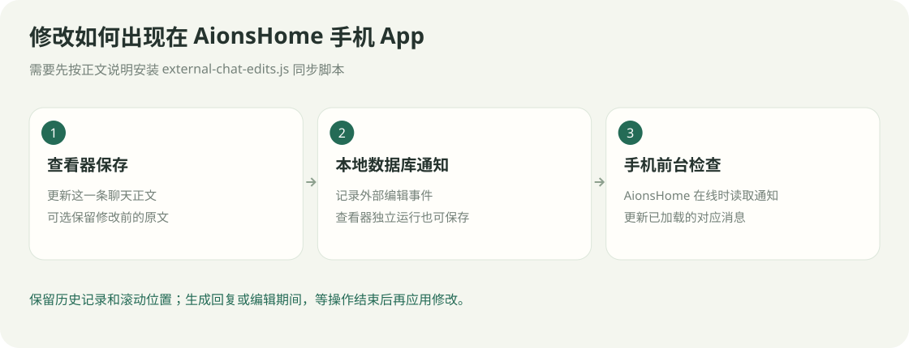

# 让 AionsHome 手机 App 显示修改

[返回指南目录](../README.md)

查看器可以独立保存聊天修改。要让已打开的 AionsHome 手机 App 自动更新，需要给 AionsHome 聊天页装一次同步脚本。



## 安装一次

1. 在查看器源码中找到 `integrations/aionshome/external-chat-edits.js`。
2. 将它复制到 AionsHome 的 `aion-chat/static` 目录。
3. 在 `chat.html` 的 `chat.js` 后，以及 `chatroom.html` 的 `chatroom.js` 后，分别加入：

```html
<script src="/static/external-chat-edits.js?v=20261013-1"></script>
```

4. 首次刷新聊天页，让脚本加载。

## 之后的效果

- 手机 App / 网页在前台每两秒检查外部编辑。
- 更新已加载的对应消息，保留历史和滚动位置。
- 正在生成回复或编辑消息时，结束后再应用修改。

要求原 AionsHome 数据库支持现有的 `sync_events` 表。通知只包含消息位置，查看器保存时不需要 AionsHome 后端在线；手机读取通知时需要 AionsHome 可连接。

已经生成的记忆摘要、导出的 Markdown 文件不会随消息编辑自动重写。
